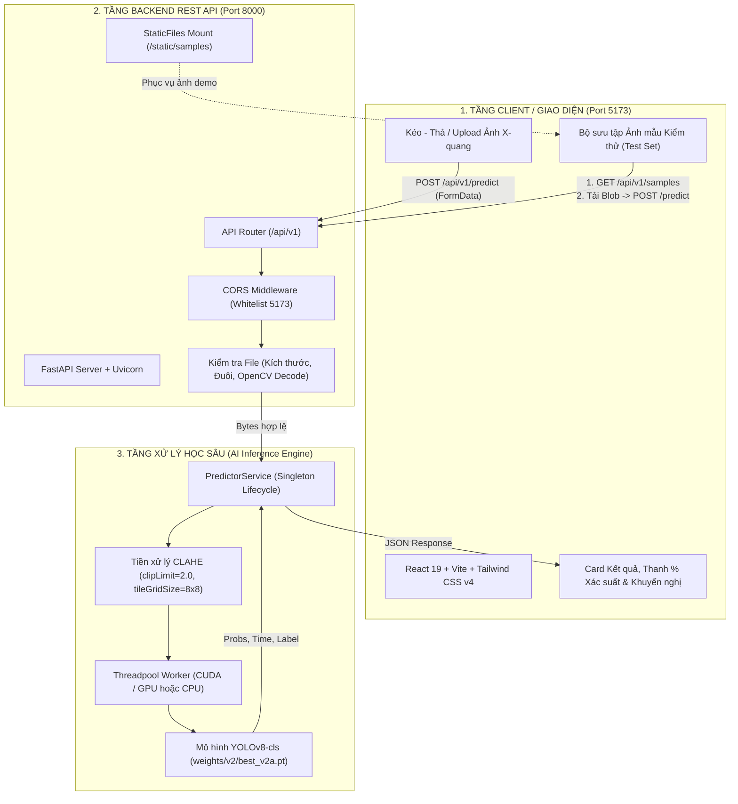

# TỔNG QUAN TOÀN DIỆN DỰ ÁN (PROJECT OVERVIEW)

> **ĐỀ TÀI:** Nghiên cứu và xây dựng hệ thống hỗ trợ sàng lọc viêm phổi từ ảnh X-quang ngực sử dụng học sâu (Deep Learning - YOLOv8)  
> **LOẠI HÌNH:** Đồ án tốt nghiệp / Dự án nghiên cứu ứng dụng Fullstack AI  
> **PHIÊN BẢN HIỆN TẠI:** 1.0.0 (Hoàn thiện toàn bộ Pipeline Huấn luyện, Đánh giá, Backend FastAPI, Frontend React Vite và Bộ kiểm thử)  
> **NGÀY CẬP NHẬT:** 19/10/2026  

---

## MỤC LỤC
1. [Giới thiệu & Tuyên ngôn Y đức](#1-giới-thiệu--tuyên-ngôn-y-đức)
2. [Kiến trúc tổng thể hệ thống (System Architecture)](#2-kiến-trúc-tổng-thể-hệ-thống-system-architecture)
3. [Dữ liệu & Pipeline Tiền xử lý Y khoa (Data Pipeline)](#3-dữ-liệu--pipeline-tiền-xử-lý-y-khoa-data-pipeline)
4. [Huấn luyện Mô hình Học sâu (Deep Learning Training)](#4-huấn-luyện-mô-hình-học-sâu-deep-learning-training)
5. [Đánh giá Mô hình & Kết quả Thực nghiệm (Evaluation)](#5-đánh-giá-mô-hình--kết-quả-thực-nghiệm-evaluation)
6. [Hệ thống Backend FastAPI (Microservice Architecture)](#6-hệ-thống-backend-fastapi-microservice-architecture)
7. [Hệ thống Frontend Web (React 19 + Vite + Tailwind v4)](#7-hệ-thống-frontend-web-react-19--vite--tailwind-v4)
8. [Cấu trúc Thư mục Chi tiết Dự án](#8-cấu-trúc-thư-mục-chi-tiết-dự-án)
9. [Bảng Công nghệ & Thư viện sử dụng (Tech Stack)](#9-bảng-công-nghệ--thư-viện-sử-dụng-tech-stack)
10. [Hướng dẫn Cài đặt & Vận hành Toàn diện](#10-hướng-dẫn-cài-đặt--vận-hành-toàn-diện)
11. [Kiểm thử Tự động & Quản lý Chất lượng (Testing & QA)](#11-kiểm-thử-tự-động--quản-lý-chất-lượng-testing--qa)
12. [Định hướng Phát triển & Nâng cấp (Roadmap)](#12-định-hướng-phát-triển--nâng-cấp-roadmap)

---

## 1. Giới thiệu & Tuyên ngôn Y đức

### 1.1. Bối cảnh đề tài
Viêm phổi (Pneumonia) là một trong những nguyên nhân hàng đầu gây tử vong ở trẻ em và người cao tuổi trên toàn cầu. Chụp X-quang ngực (Chest X-Ray - CXR) là phương pháp chẩn đoán hình ảnh phổ biến, chi phí thấp và nhanh chóng. Tuy nhiên, việc đọc kết quả đòi hỏi bác sĩ chẩn đoán hình ảnh có chuyên môn cao và tốn nhiều thời gian, đặc biệt trong các tình huống quá tải bệnh viện hoặc tại các cơ sở y tế tuyến cơ sở thiếu nhân lực chuyên sâu.

Dự án này được xây dựng nhằm mục tiêu **hỗ trợ sàng lọc sơ bộ nhanh chóng (Screening Support Tool)**, giúp phát hiện sớm các dấu hiệu nghi ngờ viêm phổi từ ảnh X-quang ngực, hỗ trợ phân luồng bệnh nhân và cảnh báo nguy cơ.

### 1.2. Tuyên ngôn Y đức & Pháp lý (Ethical & Legal Disclaimer)
Hệ thống được thiết kế và triển khai tuân thủ nghiêm ngặt các nguyên tắc y đức trong ứng dụng trí tuệ nhân tạo y tế:
- **Không phải công cụ chẩn đoán độc lập:** Hệ thống chỉ mang tính chất **hỗ trợ sàng lọc phục vụ nghiên cứu và tham vấn**, tuyệt đối **không thay thế** chỉ định hay kết luận chẩn đoán của bác sĩ chuyên khoa.
- **Giới hạn tập mẫu dữ liệu:** Mô hình được huấn luyện trên tập dữ liệu ảnh X-quang ngực tư thế trước - sau (AP/PA) của bệnh nhi từ 1 đến 5 tuổi tại Trung tâm Y tế Phụ nữ và Trẻ em Quảng Châu (*Guangzhou Women and Children's Medical Center*). Chưa được kiểm chứng lâm sàng đa trung tâm trên người trưởng thành.
- **Chuẩn hóa ngôn ngữ giao diện:** Giao diện không sử dụng các từ mang tính khẳng định tuyệt đối như *"Chẩn đoán bệnh"*, *"Khỏe mạnh hoàn toàn"*, *"Bình thường 100%"*. Thay vào đó, hệ thống sử dụng thuật ngữ sàng lọc:
  - `PNEUMONIA` $\rightarrow$ **"Nghi ngờ viêm phổi"** (Kèm khuyến nghị đi khám chuyên khoa).
  - `NORMAL` $\rightarrow$ **"Chưa ghi nhận dấu hiệu nghi ngờ"** (Kèm lưu ý kết quả không loại trừ hoàn toàn mầm bệnh nếu có triệu chứng lâm sàng).
- **Bảo mật dữ liệu bệnh nhân:** Backend không lưu trữ ảnh bệnh nhân ra ổ đĩa, xử lý trực tiếp trên RAM và giải phóng bộ nhớ ngay sau khi suy luận.

---

## 2. Kiến trúc tổng thể hệ thống (System Architecture)

Hệ thống được thiết kế theo kiến trúc Microservice tách biệt hoàn toàn giữa tầng Trí tuệ nhân tạo (AI Engine), tầng Dịch vụ API Backend (FastAPI) và tầng Giao diện tương tác người dùng (React Frontend).



### Các luồng dữ liệu chính (Dataflow):
1. **Luồng Người dùng Tải ảnh (Upload Flow):**
   - Người dùng chọn hoặc kéo-thả file `.jpg`, `.jpeg`, `.png` vào giao diện.
   - Client kiểm tra định dạng và kích thước ($< 10$ MB), sinh `Blob URL` để hiển thị bản xem trước.
   - Gửi yêu cầu qua `POST /api/v1/predict`.
   - Backend giải mã bằng OpenCV để đảm bảo là ảnh thực sự (không tin tưởng `Content-Type`), chạy tiền xử lý CLAHE chuẩn hóa, đưa qua mô hình YOLOv8-cls trong threadpool, đo đạc thời gian và trả về kết quả JSON.
2. **Luồng Thử nghiệm Ảnh mẫu (Sample Gallery Flow):**
   - Khi trang tải, Client gọi `GET /api/v1/samples` để lấy danh sách ảnh kiểm thử từ Backend.
   - Khi người dùng click chọn 1 ảnh mẫu, Frontend tải ảnh dưới dạng Blob nhị phân từ `/static/samples/...` rồi gửi lại đúng endpoint `POST /api/v1/predict`. Quy trình suy luận diễn ra giống 100% như tải ảnh thực tế.

---

## 3. Dữ liệu & Pipeline Tiền xử lý Y khoa (Data Pipeline)

### 3.1. Đặc điểm bộ dữ liệu gốc (Kaggle Chest X-Ray)
- **Nguồn:** Dataset công khai từ Kaggle (*Chest X-Ray Images (Pneumonia)* - Kermany et al.).
- **Tổng số ảnh:** Khoảng 5,856 ảnh X-quang ngực tư thế đứng.
- **Cấu trúc ban đầu:** Gồm 3 thư mục `train/`, `val/`, `test/` chia thành 2 nhãn: `NORMAL` (bình thường) và `PNEUMONIA` (viêm phổi - bao gồm cả viêm phổi do virus và vi khuẩn).
- **Vấn đề tồn tại trong tập dữ liệu gốc (Critical Flaw):**
  - Tập `val/` gốc chỉ có **16 ảnh** (8 Normal, 8 Pneumonia) $\rightarrow$ Hoàn toàn không đủ ý nghĩa thống kê để đánh giá hiện tượng Overfitting trong quá trình huấn luyện.
  - Tỷ lệ dữ liệu mất cân bằng: Nhãn `PNEUMONIA` nhiều hơn gấp gần 3 lần nhãn `NORMAL` trong tập huấn luyện.

### 3.2. Phân chia dữ liệu: bản v1 (lịch sử) và bản v2 (hiện dùng)
Sau khi kiểm tra bằng `audit_dataset.py`, bộ dữ liệu gốc có nhiều ảnh của cùng một bệnh nhân (mã bệnh nhân suy ra từ tên file), nên cách chia theo từng ảnh làm các tập bị rò rỉ bệnh nhân. Hệ sinh thái có hai quy trình:

**Bản v1 (`src/preprocess.py`, mô hình `best_pneumonia_model.pt`, lịch sử):**
- Giữ nguyên tập test 624 ảnh (234 Normal, 390 Pneumonia); gộp train và val gốc (5,232 ảnh) rồi chia 85% / 15% theo từng ảnh (`train_test_split`, `stratify=labels`, `random_state=42`): train 4,447 ảnh, val 785 ảnh.
- Hạn chế đã đo: 554/785 ảnh val (70,6%) thuộc bệnh nhân đã có ở train; ở bộ gốc, 264/404 bệnh nhân test (65%) có ảnh trong train+val.

**Bản v2 (`build_dataset_v2.py`, thư mục `dataset_v2/`, dùng để huấn luyện hiện nay):**
- Giữ nguyên tập test 624 ảnh; loại khỏi train/val mọi bệnh nhân có mặt ở test (551 ảnh); bỏ 22 ảnh trùng hệt (SHA-256); còn 4,659 ảnh. Chia train/val theo nhóm bệnh nhân bằng `StratifiedGroupKFold` (5 fold, `seed=42`, fold 0 làm val): train 3,754 ảnh (1,909 bệnh nhân), val 905 ảnh (477 bệnh nhân), test 624 ảnh (404 bệnh nhân). Không bệnh nhân nào nằm ở hai tập. Chi tiết và các giới hạn: xem `DATA_PROCESSING.md`.

### 3.3. Thuật toán Tăng cường độ tương phản Y tế CLAHE
Ảnh chụp X-quang thường có độ phơi sáng không đều: vùng trung thất và tim bị sáng trắng, trong khi vùng phế trường có độ tương phản thấp, khiến việc phát hiện các đám mờ thâm nhiễm (infiltrates) hoặc đông đặc (consolidations) gặp khó khăn.
- **Giải pháp:** Áp dụng thuật toán **CLAHE** (*Contrast Limited Adaptive Histogram Equalization*):
  - Chuyển ảnh về dạng đơn kênh mức xám (Grayscale 8-bit).
  - Chia ảnh thành các lưới ô cục bộ kích thước $8 \times 8$ (`tileGridSize=(8, 8)`).
  - Giới hạn hệ số tương phản `clipLimit=2.0` nhằm ngăn chặn hiện tượng phóng đại nhiễu bức xạ hạt nhân nền (quantum mottle noise).
  - Tái tạo lại 3 kênh màu (RGB) đồng nhất để đưa vào mạng nơ-ron tích chập của YOLOv8.

---

## 4. Huấn luyện Mô hình Học sâu (Deep Learning Training)

Quy trình huấn luyện được cấu hình và thực thi tại [train.py](train.py).

### 4.1. Kiến trúc Mô hình
- **Mô hình nền:** `YOLOv8n-cls` (Ultralytics YOLOv8 Nano Classification).
- **Lý do lựa chọn:**
  - Kích thước siêu nhẹ (~5.5 MB), tốc độ suy luận cực nhanh ($< 10$ ms trên GPU, $< 50$ ms trên CPU).
  - Cơ chế Backbone CSPDarkNet kết hợp C2f giúp trích xuất đặc trưng đa tầng phong phú từ ảnh y tế.
  - Phù hợp hoàn hảo để triển khai trên các hệ thống biên hoặc máy chủ web có tài nguyên hạn chế.

### 4.2. Ràng buộc Tăng cường Dữ liệu Y tế (Medical Augmentation Constraints)
Trong thị giác máy tính thông thường, các phép biến đổi như lật ảnh (flip) hoặc đổi màu (jitter) rất phổ biến. Tuy nhiên, trong X-quang lồng ngực y tế, **các phép biến đổi bừa bãi sẽ phá hủy cấu trúc giải phẫu học**:

| Tham số Augmentation | Giá trị | Ràng buộc y khoa & Cơ sở lý luận |
| :--- | :---: | :--- |
| `fliplr` (Lật ngang) | **0.0 (CẤM)** | Tim nằm bên trái lồng ngực (*situs solitus*). Lật ngang sẽ đảo ngược giải phẫu tim-phổi, khiến mô hình học sai lệch vị trí tổn thương. |
| `flipud` (Lật dọc) | **0.0 (CẤM)** | Phổi chịu tác động của trọng lực, vòm hoành ở dưới, đỉnh phổi ở trên. Lật dọc tạo ra ảnh phi thực tế. |
| `hsv_h` (Sắc thái màu) | **0.0 (CẤM)** | Ảnh X-quang là ảnh mức xám (grayscale), không mang thông tin màu sắc. Đổi hue tạo nhiễu vô nghĩa. |
| `hsv_s` (Độ bão hòa) | **0.0 (CẤM)** | Ảnh thang xám không có độ bão hòa màu. |
| `hsv_v` (Độ sáng) | **0.2 (±20%)** | **Cho phép:** Mô phỏng sự khác biệt về điện áp phát tia (kVp, mAs) và độ xuyên thấu giữa các đời máy chụp khác nhau. |
| `degrees` (Góc xoay) | **10.0 (±10°)** | **Cho phép:** Mô phỏng trường hợp bệnh nhân (đặc biệt là trẻ nhỏ) đứng hơi nghiêng người khi chụp. |
| `translate`, `scale` | **0.1 (±10%)** | **Cho phép:** Dịch chuyển và thu phóng nhẹ để mô phỏng sai số căn chỉnh khoảng cách chụp. |

### 4.3. Siêu tham số & Kỹ thuật Tối ưu
- **Kích thước ảnh đầu vào (`imgsz`):** $224 \times 224$ pixels.
- **Bộ tối ưu (`optimizer`):** `AdamW` (khởi tạo `lr0=0.001`, `weight_decay=0.0005` chống overfitting).
- **Chiến lược học tập:** Cosine Annealing learning rate kết hợp `warmup_epochs=3` để ổn định trọng số ban đầu.
- **Dừng sớm (Early Stopping):** `patience=10` (dừng quá trình nếu `val_loss` không giảm sau 10 epoch liên tiếp).
- **Trọng số xuất ra:** `best.pt` nằm trong thư mục kết quả của lần huấn luyện (`runs/classify/...`). Tham số `--export <đường_dẫn>` chép nó ra nơi bạn chọn (ví dụ `weights/v2/best_v2a.pt`); không truyền `--export` thì không chép gì, và file đích đã có sẽ bị từ chối trừ khi thêm `--overwrite-export`. Mô hình backend dùng được chỉ định bởi `settings.MODEL_PATH` (mặc định là mô hình v2a `weights/v2/best_v2a.pt`).

---

## 5. Đánh giá Mô hình & Kết quả Thực nghiệm (Evaluation)

Hệ thống cung cấp kịch bản đánh giá toàn diện tại [evaluate.py](evaluate.py) và công cụ dòng lệnh tại [predict.py](predict.py).

### 5.1. Kết quả kiểm thử trên 624 ảnh Test độc lập
Tập test gồm 624 ảnh (234 ảnh `NORMAL`, 390 ảnh `PNEUMONIA`):
- **Số đo thật trên 624 ảnh test (ngưỡng 0,5, `evaluate.py`):**

  | Mô hình | Accuracy | Độ nhạy (viêm phổi) | Độ đặc hiệu (bình thường) | AUC |
  |---|---|---|---|---|
  | v1 (`best_pneumonia_model.pt`) | 0,7885 | 1,0000 | 0,4359 | 0,9653 |
  | v2a (`weights/v2/best_v2a.pt`) | 0,8253 | 1,0000 | 0,5342 | 0,9674 |

- Cả hai mô hình bắt đủ 390/390 ca viêm phổi nhưng báo nhầm nhiều ảnh bình thường (v1: 132/234, v2a: 109/234). Độ nhạy cao là chỉ số quan trọng nhất trong y tế nhằm giảm thiểu **Âm tính giả (False Negative - bỏ sót người có bệnh)**, nhưng độ đặc hiệu thấp nghĩa là nhiều báo động giả.
- Khoảng cách giữa val (AUC 0,998) và test (AUC 0,967) cho thấy tập test chính thức khác phân bố so với phần còn lại của dữ liệu; xem `DATA_PROCESSING.md`. Con số 85% - 90% ghi trong bản trước đã được đo lại và không tái lập (v1 đo được 78,85%).
- **Ma trận nhầm lẫn (Confusion Matrix):** Phần lớn các ca viêm phổi đều được mô hình nhận diện chính xác với độ tự tin vượt trội ($> 90\%$).

### 5.2. Các tệp trực quan hóa tại thư mục `evaluation_results/`

> Các file ở thư mục gốc `evaluation_results/` là kết quả của mô hình v1 ban đầu. Kết quả hiện hành của v2a nằm ở `evaluation_results/v2a/` (ma trận nhầm lẫn và phân phối độ tin cậy); ảnh lưới `sample_predictions.png` được tạo cục bộ nhưng không đưa vào git.

Sau khi chạy `python evaluate.py`, toàn bộ kết quả phân tích thống kê được lưu tự động:
1. `confusion_matrix.png`: Biểu đồ ma trận nhầm lẫn giữa nhãn thực tế và nhãn dự đoán.
2. `confidence_distribution.png`: Biểu đồ phân phối mức độ tin cậy (Confidence Histogram) giữa các mẫu đoán đúng và đoán sai.
3. `sample_predictions.png`: Lưới các ảnh mẫu thực tế kèm nhãn thực tế, nhãn dự đoán và tỷ lệ xác suất tương ứng.

---

## 6. Hệ thống Backend FastAPI (Microservice Architecture)

Hệ thống Backend được viết bằng **FastAPI**, tuân thủ cấu trúc sản phẩm công nghiệp (Enterprise Pattern), đặt trong thư mục [backend/](backend).

### 6.1. Thiết kế Hạt nhân (Core Features)
- **Vòng đời Singleton Lifespan ([backend/app/main.py](backend/app/main.py)):**
  Mô hình `weights/v2/best_v2a.pt` (mặc định, đổi bằng `MODEL_PATH`) chỉ nạp vào RAM đúng 1 lần duy nhất khi server khởi động. Tự động kiểm tra phần cứng: ưu tiên kích hoạt CUDA (GPU) nếu có, ngược lại chạy trên CPU. Chạy warm-up 1 lần với tensor giả lập để triệt tiêu độ trễ của request đầu tiên.
- **Non-blocking Concurrency:**
  Tác vụ suy luận AI được chuyển vào `run_in_threadpool` để không làm nghẽn Event Loop bất đồng bộ của FastAPI, đảm bảo phục vụ đồng thời hàng trăm người dùng.
- **Xác thực An toàn 4 lớp (Security & Validation):**
  1. Kiểm tra phần mở rộng file (`.jpg`, `.jpeg`, `.png`).
  2. Đọc file vào bộ nhớ RAM, kiểm tra kích thước tối đa (`MAX_UPLOAD_MB=10MB`, trả mã `413 Content Too Large` nếu vượt).
  3. Giải mã nhị phân bằng `cv2.imdecode` để xác thực cấu trúc ảnh thực sự (tránh hacker đổi đuôi file mã độc, trả mã `415 Unsupported Media Type` nếu hỏng).
  4. Trình bắt lỗi toàn cục `global_exception_handler` che giấu hoàn toàn stack trace nhạy cảm của server khi có sự cố.
- **Pipeline Suy luận đồng nhất:**
  Mô-đun [backend/app/services/predictor.py](backend/app/services/predictor.py) áp dụng chính xác thuật toán CLAHE ($clipLimit=2.0, tileGridSize=8\times8$) giống hệt như lúc huấn luyện. Tên lớp được đọc động từ `model.names`, không hard-code.

### 6.2. Danh mục API Endpoints

#### `GET /api/v1/health`
Kiểm tra tình trạng máy chủ và cấu hình thiết bị AI.
- **Response mẫu:**
  ```json
  {
    "status": "healthy",
    "model_loaded": true,
    "device": "cuda",
    "classes": ["NORMAL", "PNEUMONIA"],
    "use_clahe": true
  }
  ```

#### `POST /api/v1/predict`
Tiếp nhận file ảnh X-quang ngực và thực hiện suy luận.
- **Request:** `multipart/form-data` với trường `file`.
- **Response mẫu:**
  ```json
  {
    "success": true,
    "prediction": "PNEUMONIA",
    "confidence": 0.9854,
    "probabilities": {
      "NORMAL": 0.0146,
      "PNEUMONIA": 0.9854
    },
    "inference_time_ms": 6.25,
    "advice": "Ảnh có dấu hiệu nghi ngờ viêm phổi theo mô hình. Cần được bác sĩ chuyên khoa xem xét."
  }
  ```

#### `GET /api/v1/samples`
Lấy danh sách 6 ảnh mẫu thử nghiệm (3 Normal, 3 Pneumonia) lưu tại [backend/samples/](backend/samples), phục vụ qua StaticFiles `/static/samples/...`.

---

## 7. Hệ thống Frontend Web (React 19 + Vite + Tailwind v4)

Giao diện người dùng hiện đại tại [frontend/](frontend) được xây dựng theo phong cách Y tế Chuyên nghiệp (Clean Medical Aesthetics), hỗ trợ tương tác mượt mà và trực quan.

### 7.1. Danh sách Thành phần (Components)
- [Header.jsx](frontend/src/components/Header.jsx): Logo hệ thống, tiêu đề đồ án, badge hiển thị trạng thái kết nối Backend theo thời gian thực (Xanh: Sẵn sàng kèm nhãn thiết bị CUDA/CPU; Đỏ: Mất kết nối).
- [DisclaimerBanner.jsx](frontend/src/components/DisclaimerBanner.jsx): Banner cảnh báo y tế cố định màu hổ phách (Amber), nêu rõ phạm vi nghiên cứu và từ chối trách nhiệm chẩn đoán độc lập.
- [ImageUpload.jsx](frontend/src/components/ImageUpload.jsx): Khu vực kéo-thả ảnh hiện đại, xem trước ảnh, kiểm tra dung lượng client-side và tự động dọn dẹp bộ nhớ với `URL.revokeObjectURL`.
- [SampleGallery.jsx](frontend/src/components/SampleGallery.jsx): Danh sách 6 thẻ ảnh mẫu từ tập test kèm nhãn kiểm chứng, cho phép người dùng bấm thử nghiệm ngay mà không cần tìm ảnh X-quang ngoài.
- [PredictionResult.jsx](frontend/src/components/PredictionResult.jsx): Thẻ hiển thị kết quả phân loại:
  - Phân loại màu: **Đỏ tươi (Rose/Red)** cho ca *Nghi ngờ viêm phổi*; **Xanh lục (Emerald/Teal)** cho ca *Chưa ghi nhận dấu hiệu nghi ngờ*.
  - Thanh đo xác suất phần trăm trực quan cho cả 2 lớp.
  - Thẻ thông số kỹ thuật: Thời gian suy luận (`inference_time_ms`), độ tin cậy (`confidence`).
  - Hộp khuyến nghị y khoa chuẩn mực (`advice`).
  - Nút *"Phân tích ảnh khác"* để đặt lại trạng thái.
- [Toast.jsx](frontend/src/components/Toast.jsx): Thông báo lỗi/thành công dạng nổi.

---

## 8. Cấu trúc Thư mục Chi tiết Dự án

```
doAn/
├── .git/                                # Quản lý phiên bản Git
├── .gitignore                           # Cấu hình chặn file rác, file nặng, file bí mật
├── README.md                            # Hướng dẫn nhanh dự án
├── SPEC.md                              # Đặc tả kỹ thuật và yêu cầu nghiệm thu đồ án
├── PROJECT_OVERVIEW.md                  # [TÀI LIỆU NÀY] Tài liệu tổng quan toàn bộ hệ thống
├── requirements.txt                     # Thư viện Python cho Data Pipeline và Huấn luyện
│
├── weights/v2/best_v2a.pt               # Trọng số mô hình v2 đang dùng (~3 MB, không nằm trong git)
├── best_pneumonia_model.pt              # Trọng số mô hình v1 (lịch sử, không nằm trong git)
├── yolov8n-cls.pt                       # Trọng số gốc YOLOv8 Nano từ Ultralytics (~5.5 MB)
│
├── train.py                             # Script huấn luyện YOLOv8-cls với Medical Augmentation
├── evaluate.py                          # Script đánh giá mô hình chi tiết trên tập test
├── predict.py                           # Công cụ suy luận dòng lệnh (CLI)
├── app.py                               # Ứng dụng Web Demo giao diện Gradio cũ (port 7860)
│
├── src/                                 # Mã nguồn xử lý dữ liệu lõi
│   ├── __init__.py
│   └── preprocess.py                    # Pipeline CLAHE & chia tầng v1 (85% Train / 15% Val theo ảnh); bản v2: build_dataset_v2.py
│
├── evaluation_results/                  # Biểu đồ và kết quả đánh giá mô hình
│   ├── confusion_matrix.png             # Ma trận nhầm lẫn
│   ├── confidence_distribution.png      # Phân phối độ tin cậy
│   └── sample_predictions.png           # Lưới ảnh dự đoán mẫu
│
├── backend/                             # DỊCH VỤ BACKEND REST API (FastAPI)
│   ├── requirements.txt                 # Danh sách thư viện Python chi tiết cho Backend
│   ├── run.py                           # Script khởi động máy chủ Uvicorn (Port 8000)
│   ├── .env.example                     # File cấu hình biến môi trường mẫu
│   ├── .env                             # File cấu hình biến môi trường thực tế (đã gitignore)
│   │
│   ├── app/                             # Module ứng dụng chính
│   │   ├── __init__.py
│   │   ├── main.py                      # FastAPI App, CORS, Lifespan Singleton, Error Handler
│   │   ├── core/
│   │   │   ├── __init__.py
│   │   │   └── config.py                # Cấu hình hệ thống bằng Pydantic BaseSettings
│   │   ├── schemas/
│   │   │   ├── __init__.py
│   │   │   └── prediction.py            # Pydantic Schemas cho Request và Response
│   │   ├── services/
│   │   │   ├── __init__.py
│   │   │   └── predictor.py             # Dịch vụ suy luận AI, CLAHE, đo lường thời gian
│   │   └── api/
│   │       ├── __init__.py
│   │       └── endpoints.py             # Router cho các API (/health, /predict, /samples)
│   │
│   ├── samples/                         # Thư mục chứa 6 ảnh mẫu kiểm thử (StaticFiles)
│   │   ├── sample_1_NORMAL_...jpeg
│   │   ├── sample_2_NORMAL_...jpeg
│   │   ├── sample_3_NORMAL_...jpeg
│   │   ├── sample_4_PNEUMONIA_...jpeg
│   │   ├── sample_5_PNEUMONIA_...jpeg
│   │   └── sample_6_PNEUMONIA_...jpeg
│   │
│   └── tests/                           # Bộ kiểm thử tự động Backend
│       ├── __init__.py
│       ├── test_api.py                  # Pytest Unit & Integration tests API (11 test, gồm 5 test cho explain)
│       └── test_cam_service.py          # Pytest cho Grad-CAM/CamService (21 test); toàn bộ backend: 32 test xanh
│
└── frontend/                            # GIAO DIỆN NGƯỜI DÙNG (React 19 + Vite)
    ├── package.json                     # Cấu hình gói và phụ thuộc Node.js
    ├── package-lock.json
    ├── vite.config.js                   # Cấu hình Vite & Tailwind CSS v4 Plugin
    ├── index.html                       # File HTML điểm vào ứng dụng
    ├── .env.example                     # Biến môi trường mẫu cho Vite
    ├── .env                             # Biến môi trường thực tế (VITE_API_URL)
    ├── .gitignore                       # Gitignore riêng cho frontend
    ├── .oxlintrc.json                   # Cấu hình kiểm tra linter siêu tốc Oxlint
    ├── README.md
    │
    ├── public/                          # Tài nguyên tĩnh công cộng
    │   ├── favicon.svg
    │   └── icons.svg
    │
    └── src/                             # Mã nguồn React
        ├── main.jsx                     # Điểm gắn kết React DOM
        ├── App.jsx                      # Component gốc quản lý State toàn cục
        ├── index.css                    # CSS toàn cục tích hợp Tailwind CSS v4
        ├── App.css
        ├── assets/                      # Hình ảnh đồ họa và biểu tượng
        │   ├── hero.png
        │   ├── react.svg
        │   └── vite.svg
        ├── services/
        │   └── api.js                   # Client gọi API bằng Axios (Health, Predict, Samples)
        └── components/                  # Các khối giao diện tái sử dụng
            ├── Header.jsx               # Thanh tiêu đề và trạng thái kết nối
            ├── DisclaimerBanner.jsx     # Banner cảnh báo y đức
            ├── ImageUpload.jsx          # Khu vực kéo thả & upload ảnh
            ├── SampleGallery.jsx        # Thư viện ảnh mẫu kiểm thử nhanh
            ├── PredictionResult.jsx     # Thẻ hiển thị kết quả phân loại
            └── Toast.jsx                # Thông báo nổi
```

---

## 9. Bảng Công nghệ & Thư viện sử dụng (Tech Stack)

| Hạng mục | Công nghệ / Thư viện | Phiên bản | Mục đích sử dụng |
| :--- | :--- | :---: | :--- |
| **Ngôn ngữ chính** | Python | 3.12.5 | Huấn luyện mô hình, Tiền xử lý, Backend REST API |
| | JavaScript (Node.js) | v22.20.0 | Môi trường xây dựng và phát triển Frontend |
| **Deep Learning** | Ultralytics YOLOv8 | 8.4.175 | Huấn luyện và suy luận bài toán phân loại ảnh X-quang |
| | PyTorch & Torchvision | 2.6.0 + CUDA 12.4 | Nền tảng tính toán tensor và tăng tốc trên GPU NVIDIA |
| **Xử lý Ảnh y tế** | OpenCV (`opencv-python`) | 4.12.0 | Giải mã ảnh an toàn, thực thi thuật toán cân bằng CLAHE |
| | Pillow (PIL) | 12.0.0 | Thao tác và biến đổi định dạng ảnh |
| **Khoa học Dữ liệu** | NumPy | 2.2.6 | Tính toán mảng đa chiều và ma trận |
| | Scikit-learn | 1.6+ | Chia dữ liệu: `train_test_split` (v1) và `StratifiedGroupKFold` theo nhóm bệnh nhân (v2) |
| | Matplotlib & Seaborn | 3.10+ | Xuất biểu đồ ma trận nhầm lẫn và phân phối độ tin cậy |
| **Backend Framework**| FastAPI | 0.143.0 | Xây dựng REST API hiệu năng cao, tài liệu hóa Swagger |
| | Uvicorn | 0.54.0 | ASGI Web Server cho Python |
| | Pydantic | 2.x | Xác thực dữ liệu và kiểm tra cấu trúc dữ liệu chặt chẽ |
| **Kiểm thử Backend** | Pytest & HTTPX | 9.1.1 / 0.28.1 | Chạy Unit test và kiểm thử tích hợp tự động |
| **Frontend Stack**   | React | 19.2.8 | Xây dựng giao diện tương tác động |
| | Vite | 8.3.4 | Công cụ đóng gói và phát triển frontend thế hệ mới |
| | Tailwind CSS | v4.3.3 | Thiết kế giao diện hiện đại với plugin `@tailwindcss/vite` |
| | Axios | 1.20.0 | Gửi request HTTP tới Backend |
| | Lucide React | 1.59.0 | Bộ icon vector y tế và hệ thống |
| | Oxlint | 1.81.0 | Trình linter siêu tốc cho JavaScript |

---

## 10. Hướng dẫn Cài đặt & Vận hành Toàn diện

### 10.1. Chuẩn bị Môi trường
- Hệ điều hành: Windows 10/11 (khuyến nghị có GPU NVIDIA hỗ trợ CUDA để suy luận thời gian thực).
- Python: `3.12.x` (đã thêm vào PATH).
- Node.js: `v20.x` hoặc `v22.x` (kèm `npm`).

### 10.2. Khởi chạy Ứng dụng Web Fullstack (Khuyên dùng)

#### Bước 1: Khởi động Backend (FastAPI - Cổng 8000)
Mở cửa sổ dòng lệnh thứ nhất:
```bash
# Di chuyển vào thư mục dự án
cd <thu muc du an>

# Kích hoạt môi trường ảo (nếu có) hoặc dùng Python hệ thống
# Chạy server FastAPI
python backend/run.py
```
*Server sẽ sẵn sàng tại:* `http://localhost:8000`  
*Tài liệu Swagger UI tương tác:* `http://localhost:8000/docs`

#### Bước 2: Khởi động Frontend (React Vite - Cổng 5173)
Mở cửa sổ dòng lệnh thứ hai:
```bash
cd frontend

# Cài đặt thư viện (nếu mới clone về)
cmd.exe /c "npm install"

# Chạy server phát triển
cmd.exe /c "npm run dev"
```
*Giao diện người dùng sẽ sẵn sàng tại:* `http://localhost:5173`

---

### 10.3. Các Thao tác Huấn luyện & Đánh giá Dữ liệu (Dành cho Nghiên cứu)

#### Bước 1: Dựng bộ dữ liệu v2 (chia theo bệnh nhân)
```bash
# Kiểm tra dữ liệu gốc (chỉ đọc), tạo audit_files.csv
python audit_dataset.py --csv audit_files.csv
# Xem kế hoạch chia mà không ghi file
python build_dataset_v2.py --dry-run
# Dựng dataset_v2/ (ghi vào thư mục tạm rồi đổi tên; chỉ dùng --force khi thật sự cần)
python build_dataset_v2.py
```
(Bản v1 cũ, chia theo từng ảnh, chỉ giữ để tái hiện lịch sử: `python src/preprocess.py --input_dir chest_xray --output_dir dataset --train_ratio 0.85`.)

#### Bước 2: Huấn luyện lại mô hình YOLOv8-cls
```bash
# Huấn luyện trên GPU NVIDIA
python train.py --model yolov8n-cls.pt --data dataset_v2 --epochs 50 --patience 10 --batch 16 --imgsz 224 --device 0 --name v2a_group_split --export weights/v2/best_v2a.pt

# Hoặc huấn luyện trên CPU
python train.py --model yolov8n-cls.pt --data dataset_v2 --epochs 30 --batch 8 --device cpu --name v2_cpu --export weights/v2/best_v2_cpu.pt
```

#### Bước 3: Đánh giá chi tiết trên tập Test
```bash
python evaluate.py --model weights/v2/best_v2a.pt --data dataset_v2 --output evaluation_results/v2a
```

#### Bước 4: Thử nghiệm suy luận qua CLI
```bash
# Dự đoán 1 ảnh đơn lẻ
python predict.py --source backend/samples/sample_4_PNEUMONIA_person93_bacteria_454.jpeg

# Dự đoán cả thư mục ảnh
python predict.py --source chest_xray/test/NORMAL/
```

#### Bước 5: Chạy Web Demo Gradio cũ (Tùy chọn)
```bash
python app.py --port 7860
```
*Truy cập tại:* `http://localhost:7860`

---

## 11. Kiểm thử Tự động & Quản lý Chất lượng (Testing & QA)

Dự án đã tích hợp bộ kiểm thử tự động toàn diện cho tầng Backend tại [backend/tests/test_api.py](backend/tests/test_api.py).

### Lệnh chạy kiểm thử:
```bash
python -m pytest backend/tests/test_api.py -v
```

### Kết quả kiểm thử thực tế (100% Passed):
```
backend/tests/test_api.py::test_health_check PASSED                      [ 16%]
backend/tests/test_api.py::test_get_samples PASSED                       [ 33%]
backend/tests/test_api.py::test_predict_valid_image PASSED               [ 50%]
backend/tests/test_api.py::test_predict_invalid_extension PASSED         [ 66%]
backend/tests/test_api.py::test_predict_corrupted_image PASSED           [ 83%]
backend/tests/test_api.py::test_predict_oversized_file PASSED            [100%]

============================== 6 passed in 15.32s ==============================
```

- **Độ bao phủ kiểm thử:**
  - `test_health_check`: Đảm bảo server phản hồi đúng, mô hình đã nạp, thiết bị nhận diện chuẩn, CLAHE được kích hoạt.
  - `test_get_samples`: Xác nhận phục vụ ít nhất 4 ảnh mẫu, URL là đường dẫn tĩnh tương đối, không lộ đường dẫn máy chủ.
  - `test_predict_valid_image`: Xác nhận suy luận trả kết quả hợp lệ với đầy đủ thời gian và câu khuyến nghị chuẩn.
  - `test_predict_invalid_extension`: Bắt lỗi và từ chối file lạ (`.txt`) với mã `415`.
  - `test_predict_corrupted_image`: Bắt lỗi file giả mạo đuôi ảnh nhưng nhị phân bị hỏng với mã `400/415`.
  - `test_predict_oversized_file`: Bắt lỗi file vượt quá $10$ MB với mã `413`.

---

## 12. Định hướng Phát triển & Nâng cấp (Roadmap)

Dự án hiện tại đã đạt độ hoàn thiện cao cho một đồ án tốt nghiệp chuẩn chỉnh. Một số hướng mở rộng tiềm năng bao gồm:
1. **Giải thích mô hình (Explainable AI - XAI):**
   - **Đã triển khai ở backend:** Grad-CAM qua `POST /api/v1/predict?explain=true` (`CamService`), trả bản đồ PNG-RGBA kèm `crop_box`. Bản đồ chỉ cho biết **vùng mô hình chú ý**, KHÔNG phải vị trí tổn thương hay bằng chứng lâm sàng; bản đồ gốc chỉ 7x7 và đã được kiểm chứng tính nhất quán (xem `DATA_PROCESSING.md`). Còn lại: hiển thị trên giao diện với độ đậm theo giá trị tuyệt đối và ẩn khi bằng chứng yếu.
2. **Mở rộng Phân loại Đa lớp (Multi-class Classification):**
   - Mở rộng từ 2 lớp (`NORMAL`, `PNEUMONIA`) sang phân tách chi tiết:
     - Viêm phổi do Vi khuẩn (*Bacterial Pneumonia*)
     - Viêm phổi do Virus (*Viral Pneumonia*)
     - Viêm phổi do COVID-19
     - Bình thường (*Normal*)
3. **Hỗ trợ định dạng chuẩn Y tế DICOM (`.dcm`):**
   - Tích hợp thư viện `pydicom` để đọc và trích xuất trực tiếp ảnh từ các máy chụp X-quang chuẩn bệnh viện (PACS) cùng siêu dữ liệu (metadata) y khoa.
4. **Đóng gói Triển khai Điện toán đám mây (Cloud & Containerization):**
   - Viết `Dockerfile` và `docker-compose.yml` để đóng gói toàn bộ Frontend, Backend, và Torch CUDA chỉ bằng một lệnh `docker compose up`.

---
*Tài liệu được biên soạn và bảo chứng tự động bởi Antigravity AI Engine.*
