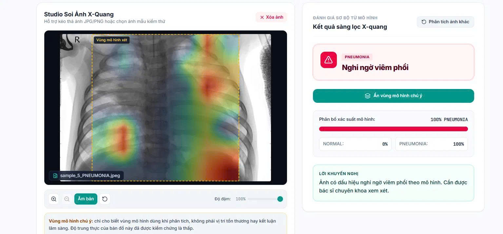

# Hệ Thống Hỗ Trợ Sàng Lọc Viêm Phổi Từ Ảnh X-Quang Ngực

    

> ⚠️ **TUYÊN BỐ MIỄN TRỪ TRÁCH NHIỆM Y KHOA:**
> Đây là công cụ **hỗ trợ sàng lọc** phục vụ nghiên cứu và học thuật, **không thay thế bác sĩ** và chưa được kiểm chứng lâm sàng. Kết quả phân loại và bản đồ Grad-CAM chỉ phản ánh "vùng mô hình chú ý", **không phải bằng chứng lâm sàng hay vị trí tổn thương**. Mọi quyết định y tế phải do bác sĩ chuyên khoa đưa ra.

**English summary.** A pneumonia *screening-support* tool for pediatric chest X-rays: a YOLOv8n-cls classifier, a FastAPI backend and a React front end. The project audits the public Kaggle dataset, finds patient-level leakage between splits and rebuilds the splits by patient. Evaluation is deliberately honest (AUC with patient-level confidence intervals, shortcut analysis). A Grad-CAM service is implemented and its faithfulness is tested; the result is that the heatmaps have *low* faithfulness, so the UI hides them by default and always shows a warning. 33 automated tests. Dataset license: CC BY 4.0 (see "Giấy phép và ghi công").

<p align="center">
  
</p>
<p align="center"><em>Giao diện: kết quả "Nghi ngờ viêm phổi" kèm lớp phủ "vùng mô hình chú ý" (ẩn mặc định, có cảnh báo độ trung thực thấp).</em></p>

---

## Giới thiệu

Đồ án xây dựng quy trình đầy đủ từ dữ liệu đến ứng dụng: kiểm tra và chia lại bộ dữ liệu X-quang ngực (Kaggle *Chest X-Ray Images (Pneumonia)*), huấn luyện mô hình **YOLOv8-cls**, đánh giá có kiểm chứng, giải thích mô hình bằng **Grad-CAM**, và một ứng dụng web (FastAPI + React).

Hai lớp đầu ra:
- **`NORMAL`**: hiển thị "Chưa ghi nhận dấu hiệu nghi ngờ".
- **`PNEUMONIA`**: hiển thị "Nghi ngờ viêm phổi" (theo mô hình, cần bác sĩ xem xét).

**Phạm vi dữ liệu:** ảnh X-quang ngực trẻ em 1-5 tuổi từ một cơ sở. Kết quả với ảnh ngoài phạm vi này (ví dụ người lớn, ảnh chụp lại, ảnh lấy từ mạng) không đáng tin.

## Điểm nổi bật

1. **Phát hiện và sửa rò rỉ dữ liệu theo bệnh nhân.** Trong bộ dữ liệu gốc, 65% bệnh nhân ở tập test có ảnh trong train+val. Dự án suy ra mã bệnh nhân từ tên file, dựng lại bộ chia v2 theo nhóm bệnh nhân (`StratifiedGroupKFold`, giữ nguyên tập test chuẩn 624 ảnh) và kiểm chứng độc lập: 0 bệnh nhân trùng giữa các tập.
2. **Đánh giá trung thực, không chỉ báo con số đẹp.** AUC kèm khoảng tin cậy theo bệnh nhân; v1 và v2 không khác biệt có ý nghĩa; phân tích "đường tắt": chỉ dựa vào đặc điểm file (kích thước, tỷ lệ khung, dung lượng), một mô hình rừng ngẫu nhiên đã đoán nhãn với AUC 0,999 trên val.
3. **Grad-CAM tự cài đặt, có kiểm chứng độ trung thực.** Khớp `torchcam`, nhạy với trọng số đã học; nhưng thử nghiệm ảnh nhiễu và che từng dải ảnh cho thấy bản đồ không phản ánh trung thực vùng mô hình dựa vào. Giao diện vì vậy ẩn heatmap mặc định, ẩn khi bằng chứng yếu và luôn kèm cảnh báo.
4. **Ứng dụng hoàn chỉnh và có kiểm thử.** FastAPI (singleton nạp mô hình một lần, khóa luồng cho Grad-CAM, không lưu ảnh ra đĩa) + React 19, 33 test tự động.
5. **Quy trình có thể tái lập.** Mọi con số trong tài liệu đều lấy từ script độc lập trong kho; xem [DATA_PROCESSING.md](DATA_PROCESSING.md).

## Kết quả chính (624 ảnh test, ngưỡng 0,5)

| Mô hình | Accuracy | Độ nhạy (viêm phổi) | Độ đặc hiệu (bình thường) | F1 (viêm phổi) | AUC |
|---|---|---|---|---|---|
| v1 (chia theo từng ảnh) | 0,7885 | 1,000 (390/390) | 0,436 | 0,855 | 0,965 |
| **v2a** (chia theo bệnh nhân) | **0,8253** | 1,000 (390/390) | 0,534 | 0,877 | 0,967 |

- Cả hai mô hình bắt đủ 390/390 ca viêm phổi nhưng **báo nhầm nhiều ảnh bình thường** (v2a: 109/234); về khả năng xếp hạng (AUC), v2a và v1 **không khác biệt có ý nghĩa**.
- Rò rỉ bệnh nhân ở bộ gốc là có thật (70,6% ảnh val của v1 thuộc bệnh nhân đã có ở train), nhưng tác động lên hiệu năng trên tập test chính thức không phát hiện được bằng AUC.
- Nhãn bị lẫn với đặc điểm thu nhận ảnh; độ chính xác trên val (98%) không chứng minh hiểu biết bệnh lý. Tập test chính thức khác phân bố so với phần còn lại. Mới huấn luyện một seed.

Chi tiết và các giới hạn: [DATA_PROCESSING.md](DATA_PROCESSING.md), [PROJECT_OVERVIEW.md](PROJECT_OVERVIEW.md).

---

## Tính năng

**Mô hình và dữ liệu:** YOLOv8n-cls, ảnh 224x224, tiền xử lý **CLAHE** (`clipLimit=2.0`, lưới 8x8) cho cả huấn luyện và suy luận; không lật, không đổi màu khi augmentation; script kiểm tra và chia lại dữ liệu (`audit_dataset.py`, `build_dataset_v2.py`, `compare_v1_v2.py`).

**Giải thích mô hình (Grad-CAM):** lớp `model.9.conv` (bản đồ 7x7) trên bản sao riêng của mô hình; vẽ đúng vùng mô hình xét (`crop_box`); PNG-RGBA bảng màu Turbo; độ đậm tính theo giá trị tuyệt đối, ngưỡng "bằng chứng yếu" tính từ tập val.

**Backend (FastAPI):** `explain=false` (mặc định) giữ nguyên JSON, `explain=true` thêm khóa `explain`; `CamService` lỗi không làm sập API (trả 503); từ chối file sai định dạng, file hỏng, file quá dung lượng; Swagger tại `/docs`.

**Giao diện (React 19 + Vite + Tailwind 4):** kéo thả ảnh, thư viện ảnh mẫu, lịch sử trong phiên, chế độ sáng/tối, trạng thái kết nối; studio xem ảnh (phóng to, kéo, âm bản); phân bố xác suất và lời khuyến nghị; cảnh báo "Mức tin cậy thấp" khi xác suất viêm phổi dưới 0,85; nút "Xem vùng mô hình chú ý" chỉ có với kết quả PNEUMONIA.

---

## Cấu trúc dự án

```
doAn/
├── backend/                     # Backend FastAPI
│   ├── app/                     # api/, core/, schemas/, services/ (predictor, cam_service), main.py
│   ├── samples/                 # Ảnh mẫu thử nghiệm
│   ├── tests/                   # Pytest (test_api, test_cam_service, test_model_default)
│   ├── requirements.txt
│   └── run.py                   # Khởi chạy server (cổng 8000)
├── frontend/                    # React 19 + Vite (src/components, src/config, src/services)
├── docs/images/                 # Ảnh chụp giao diện dùng trong README
├── train.py  evaluate.py  predict.py  app.py       # Huấn luyện, đánh giá, CLI, demo Gradio
├── audit_dataset.py  build_dataset_v2.py  compare_v1_v2.py   # Kiểm tra và chia lại dữ liệu
├── analyze_models.py  image_stats.py  shortcut_check.py  geometry_check.py
├── occlusion_check.py  cam_peak_location.py  val_raw_peak.py   # Phân tích mô hình và Grad-CAM
├── make_blind_annotation.py  summarize_annotation.py            # Công cụ chú thích mù
├── evaluation_results/          # Hình và kết quả đo (analysis/, v2a/, v1_on_v2/)
├── DATA_PROCESSING.md           # Nhật ký xử lý dữ liệu, đánh giá và phân tích
├── PROJECT_OVERVIEW.md          # Tổng quan kỹ thuật
├── CONTRIBUTING.md  AGENTS.md  CLAUDE.md  SPEC.md
└── README.md
```

> **Không nằm trong git:** dữ liệu (`chest_xray/`, `dataset/`, `dataset_v2/`), thư mục `weights/` và các file `.pt`. Sau khi tải mã về, tải bộ *Chest X-Ray Images (Pneumonia)* từ Kaggle vào `chest_xray/`, dựng `dataset_v2/` bằng `build_dataset_v2.py`, và đặt mô hình `weights/v2/best_v2a.pt` vào đúng vị trí (hoặc đặt biến `MODEL_PATH` trong `backend/.env`).

---

## Cài đặt

Yêu cầu: Python 3.10-3.12, Node.js 18 trở lên; GPU NVIDIA (CUDA) nên có để huấn luyện, CPU vẫn chạy được.

```bash
python -m venv venv
venv\Scripts\activate          # Windows; Linux/macOS: source venv/bin/activate
pip install -r requirements.txt
pip install -r backend/requirements.txt

cd frontend
npm install
cd ..
```

Sao chép `backend/.env.example` thành `backend/.env`; `MODEL_PATH` mặc định là `weights/v2/best_v2a.pt` (tính từ thư mục gốc). Trên Windows PowerShell, nếu `npm` bị chặn bởi chính sách thực thi, dùng `npm.cmd`.

## Vận hành

```bash
# Terminal 1: backend (cổng 8000), từ thư mục gốc
python backend/run.py

# Terminal 2: giao diện (cổng 5173)
cd frontend
npm run dev
```

- Giao diện `http://localhost:5173`; tài liệu API `http://localhost:8000/docs`; trạng thái `http://localhost:8000/api/v1/health`.
- Dòng khởi động của backend ghi tên mô hình đang dùng (`Model=best_v2a.pt`).

Dòng lệnh và huấn luyện:

```bash
python predict.py --source backend/samples/
python app.py                                   # demo Gradio tại http://localhost:7860

python audit_dataset.py --csv audit_files.csv   # kiểm tra dữ liệu gốc
python build_dataset_v2.py                      # dựng dataset_v2 (có --dry-run)
python train.py --model yolov8n-cls.pt --data dataset_v2 --epochs 50 --patience 10 --imgsz 224 --batch 16 --device 0 --name v2a_group_split --export weights/v2/best_v2a.pt
python evaluate.py --model weights/v2/best_v2a.pt --data dataset_v2 --output evaluation_results/v2a
```

## API

| Phương thức | Đường dẫn | Tham số | Chức năng |
|---|---|---|---|
| `GET` | `/api/v1/health` | Không | Trạng thái máy chủ, thiết bị, lớp phân loại |
| `POST` | `/api/v1/predict` | `file` (multipart); `explain` (query, mặc định `false`) | Phân loại ảnh; `explain=true` thêm Grad-CAM |
| `GET` | `/api/v1/samples` | Không | Danh sách ảnh mẫu |

Phản hồi khi `explain=true` (rút gọn, các số chỉ minh họa cấu trúc):

```json
{
  "success": true,
  "prediction": "PNEUMONIA",
  "confidence": 0.9852,
  "probabilities": { "NORMAL": 0.0148, "PNEUMONIA": 0.9852 },
  "explain": {
    "heatmap_base64": "iVBORw0KGgo...",
    "crop_box": { "x0": 99, "y0": 0, "x1": 399, "y1": 300 },
    "colormap": "turbo",
    "is_empty": false,
    "raw_peak": 0.6724,
    "target_class": "PNEUMONIA",
    "target_layer": "model.9.conv",
    "image_size": { "width": 500, "height": 300 },
    "attention_note": "Vùng mô hình chú ý — không phải bằng chứng lâm sàng"
  }
}
```

Mã lỗi: `400` (ảnh hỏng), `413` (quá dung lượng), `415` (sai định dạng), `503` (dịch vụ giải thích chưa sẵn sàng khi `explain=true`).

## Kiểm thử

```bash
python -m pytest backend/tests -q
```

Hiện có **33 test**: 11 test API (định dạng, giới hạn, `explain=false/true`, đồng thời, 503), 21 test Grad-CAM (cùng trọng số với mô hình dự đoán, xác suất khớp `model.predict`, công thức `crop_box`, mã hóa PNG, ngẫu nhiên hóa trọng số, khớp `torchcam`, gỡ hook), 1 test mô hình mặc định.

## Giới hạn và khuyến cáo

1. **Không thay thế bác sĩ**; chưa kiểm chứng lâm sàng.
2. **Phạm vi dữ liệu hẹp** (trẻ 1-5 tuổi, một cơ sở); ảnh ngoài phạm vi cho kết quả không đáng tin.
3. **Nhiều báo động giả** (độ đặc hiệu khoảng 0,53 ở ngưỡng 0,5); ca âm tính sát ngưỡng chưa có cảnh báo riêng.
4. **Grad-CAM không phải công cụ định vị tổn thương**; độ trung thực thấp như đã nêu.
5. **Quyền riêng tư:** ảnh xử lý trong bộ nhớ, không lưu ra đĩa; lịch sử chỉ tồn tại trong phiên.

## Giấy phép và ghi công

- **Mã nguồn:** chưa kèm tệp giấy phép, tác giả giữ mọi quyền theo mặc định; mã được công bố để xem và tham khảo. Dự án dùng thư viện [Ultralytics](https://github.com/ultralytics/ultralytics) theo AGPL-3.0; ai muốn dùng lại mã hoặc mô hình cần tự xem xét điều khoản này.
- **Dữ liệu:** bộ *Chest X-Ray Images (Pneumonia)* theo giấy phép **CC BY 4.0** (kiểm tra lại điều khoản trên trang gốc). Dữ liệu không nằm trong kho này; một vài ảnh mẫu và ảnh minh họa trong kho lấy từ bộ dữ liệu này. Trích dẫn:
  - Kermany D., Zhang K., Goldbaum M. (2018). *Labeled Optical Coherence Tomography (OCT) and Chest X-Ray Images for Classification*. Mendeley Data, V2. doi:10.17632/rscbjbr9sj.2
  - Kermany D.S., Goldbaum M., Cai W., et al. (2018). Identifying Medical Diagnoses and Treatable Diseases by Image-Based Deep Learning. *Cell* 172(5):1122-1131. doi:10.1016/j.cell.2018.02.010
  - Bản Kaggle: Paul Mooney, *Chest X-Ray Images (Pneumonia)*.

**Tác giả:** letrungkhanh ([GitHub: khanhlt2185](https://github.com/khanhlt2185)).
Quy ước đóng góp và cách cập nhật dự án: [CONTRIBUTING.md](CONTRIBUTING.md). Quy tắc dành cho trợ lý lập trình: [AGENTS.md](AGENTS.md), [CLAUDE.md](CLAUDE.md).
